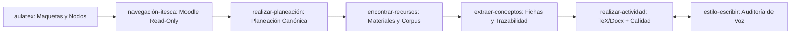

# AulaTeX agentic architecture

## Purpose

AulaTeX is a local multimodule editorial agent for institutional LaTeX work.
It adapts useful production patterns from the local reference project:

`D:\Documentos\t-books\proyectos-traducidos\30-Agents-Every-AI-Engineer-Must-Build-main_es_semantic-safe`

The app does not import that project at runtime. The patterns are implemented
inside AulaTeX so the suite remains autonomous.

## Integrated patterns

- Chapter 05: planning agent and memory-augmented agent.
- Chapter 07: tool-using agent, safe invocation, stateful workflow and audit trail.
- Chapter 08: verification and validation agent.
- Chapter 15: collective intelligence, weighted consensus and adversarial critic.

## AulaTeX roles

- Planificador editorial: turns the target into an executable editorial plan.
- Investigador documental: detects institutional context, bibliography and gaps.
- Arquitecto de plantillas: proposes report, presentation and activity structures.
- Verificador y validador: checks evidence, compilation and acceptance criteria.
- Critico adversarial: finds blockers before applying changes.

## Subject delivery layout

- Every subject has `entregas-<subject-slug>/`; obtain its path from `subject_layout()`.
- The subject slug removes the program suffix `-lde`, `-lad`, `-mga`, `-isc` or `-imtc`.
- Use `subject_artifact_contract()` in new planning models and structure inventories.
- Preserve existing delivery files and indexes. Do not create generic `Entregas/` or `entregas/` folders.
- Editable source files keep their editorial location; the delivery directory contains the files selected for submission.
- Full specification: [CONTRATO-ESTRUCTURA-MATERIAS.md](CONTRATO-ESTRUCTURA-MATERIAS.md).

## ITESCA Academic Workflow Architecture

Orchestrated by the `aulatex` master agent (`AulaTeXItescaOrchestrator`), this workflow integrates specialized autonomous agents following a strict sequential pipeline:

### Agent Roles & Contracts

1. **`aulatex` (Orquestador Maestro)**:
   - Coordinates template generation, platform navigation, editorial nodes (`IncrementalDetailPlanner`), plannings, activity generation, and multi-stage quality verification.
2. **`navegación-itesca` (Tipo: `navegación-plataforma`)**:
   - Specialized read-only navigation agent for ITESCA Virtual (`https://cursos3.e-itesca.edu.mx`).
   - Resolves credentials securely from `PlatformCredentialVault` (`account=itesca`) via `AULATEX_MASTER_PIN` without exposing passwords, cookies, session keys or PINs in any log or manifest.
   - Origin-locked to HTTPS ITESCA host, blocks mutating operations, strips `sesskey`, and enforces `live_quiz_attempt_protected` boundaries for active online quizzes.
3. **`realizar-planeación`**:
   - Consumes sanitized platform snapshots and verified local template metadata to create validated canonical plannings (`planeaciones-<slug>/planeacion-<slug>-Actividad-<N>.json`).
   - Separates confirmed teacher criteria, inferred parameters, and operational blockers. Validated against `planeacion-canonica.schema.json` and `validate_pedagogical`.
4. **`encontrar-recursos`**:
   - Downloads official teacher attachments and unit resources into `referencias-<slug>/notas-<slug>/<actividad>/material-docente/`.
   - Extracts page-tagged text (`Pagina N`) with PyMuPDF/python-docx and builds the activity `corpus-extractor/`.
5. **`extraer-conceptos`**:
   - Generates core extractor artifacts (`fichas_conceptos.json`, `.md`, `conceptos_detectados.json`, `ideas_detectadas.json`, `trazabilidad_fuentes.json`, `resumen_planeacion.json`) directly in `referencias-<slug>/notas-<slug>/<actividad>/conceptos/` and syncs them to `extractor-aulatex/conceptos-<slug>-actividad-<N>/`.
6. **`realizar-actividad`**:
   - Materializes and refines deliverables adhering strictly to subject templates and institutional covers.
   - Collaborates with `estilo-escribir`, audits typography (e.g. Arial 11/12), verifies margin bounds and citations, renders page contact sheets, and promotes verified files to `entregas-<slug>/`.
7. **`estilo-escribir`**:
   - Audits `.tex` and `.docx` prose against fourth-wall ruptures, consigna metadiscourse, robotic AI clichés, unescaped prose dollar pairs (`$100 y $120`), and unreferenced citations, enforcing an acceptable score threshold >= 88.0.

## Runtime outputs

Each agent run writes:

- `stage-*.md`: one LLM role output per stage.
- `workflow-trace.md`: state-machine audit.
- `shared-memory.md`: memory accumulated during the cycle.
- `agentic-patterns.md`: pattern catalog for the run.
- `manifest.json`: machine-readable run contract.
- `reporte-aulatex.md`: editorial report.

## Safety

- Never commit `aulaTEX/aulatex.env`.
- Never hardcode credentials.
- Keep LLM calls routed through `AulaTeXLLMClient`.
- Keep fragile tools wrapped through `safe_invoke` or `graceful_fallback`.
- Never copy credentials, encrypted secrets, PII or private document contents into notebooks, model cards, manifests or logs.
- Keep real datasets, checkpoints and model weights outside Git; version only code, configuration, tests and small manifests.
- Split training/evaluation by target or subject, never by related rows, to prevent leakage.
- Reject learned judges below their documented validation threshold.
- When the AulaTeX template is loaded, generate `\insertimage` or `images`/`\addimage`; do not emit manual `figure` + `\includegraphics`.
